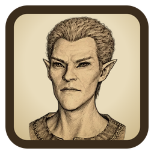

# Sepia Sketcher

Turns any picture into a sepia pencil sketch on aged paper — the same filter the
Bruma Joint Archives uses for its wanted-poster portraits.



## Download

**[Download SepiaSketcher.exe](https://github.com/Mosalah992/Sketcher/raw/main/release/SepiaSketcher.exe)** (Windows 10/11, about 3 MB, no install).

Double-click it to run. Because the app is not code-signed, Windows may show
"Windows protected your PC" the first time: click **More info → Run anyway**.

## Using it

1. Drop pictures on the window, click **Choose pictures**, or paste one with **Ctrl+V**.
2. Pick the options:
   - **Frame** — *Wanted poster* crops to the archive's 10:11 portrait frame (faces kept high); *Whole picture* keeps the full image.
   - **Size** — *Standard* is 450 × 495, exactly as on the archive; *Large* and *Huge* are 2× and 3×.
   - **Save as** — PNG, JPEG or WebP.
3. Click a sketch to view it larger (and compare with the original), then **Save…**, or **Save all…** to a folder.

Everything happens on your computer; pictures are never uploaded.

## How the filter works

A colour-dodge pencil blend (the grey image divided by a blurred negative of
itself), with Sobel edges pressed in harder, inked in sepia on paper with grain,
fading out towards the margins. See [`resources/js/sketch.js`](resources/js/sketch.js).

## Building from source

Needs [Node.js](https://nodejs.org/) 20+ on Windows.

```
npm install
npm run build
```

This writes `release/SepiaSketcher.exe`. `npm run dev` runs the app without
building, and `npm run icons` redraws the icon from `scripts/`.

The app is a [Neutralinojs](https://neutralino.js.org/) window over the system's
WebView2, with its page embedded in the single exe.

## Licences

- Sepia Sketcher: MIT, see [LICENSE](LICENSE).
- Neutralinojs: MIT, see [licenses/Neutralinojs-LICENSE.txt](licenses/Neutralinojs-LICENSE.txt).
- Cinzel and EB Garamond fonts: SIL Open Font License, see [resources/fonts](resources/fonts).
